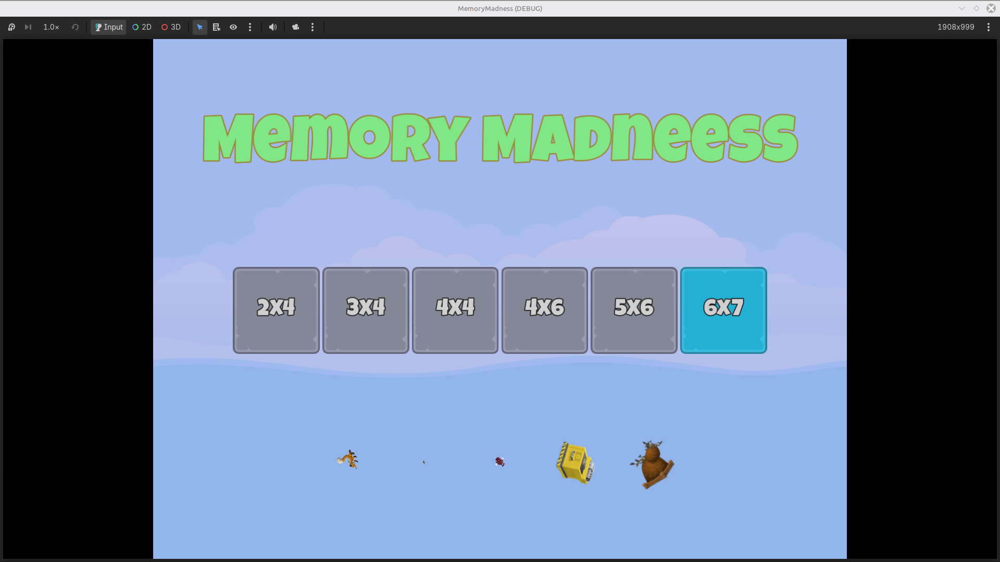
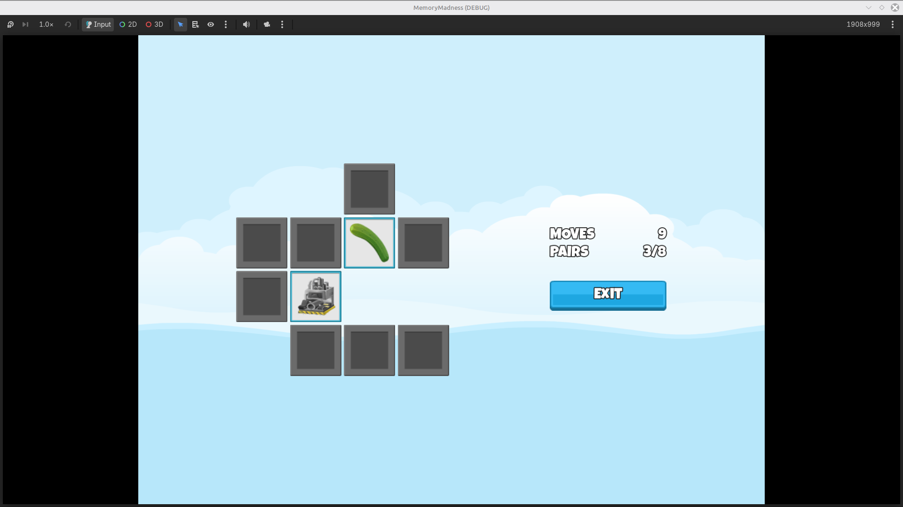

# memory-madness
A simple tile-matching memory game made using primarily UI nodes in Godot. Made in accordance with the course: "Jumpstart to 2D Game Development: Godot 4 for Beginners".

# Skills Learned
- Advanced use of UI nodes offered by Godot
- Understanding of how UI nodes work and the common issues they may lead to if not handled properly
- Application of Resource Files for large datasets
- The use of "tweens" when animating or manipulating object behaviour

# Challenges Encountered
- Making modular code that can be reused for different levels
- Adaptive UI elements

# Solutions to Challenges
- Creating a placeholder scene that automatically fixes itself based on passed arguments
- Learning how to properly use UI anchors and container sizing

# In-Game Screenshots

